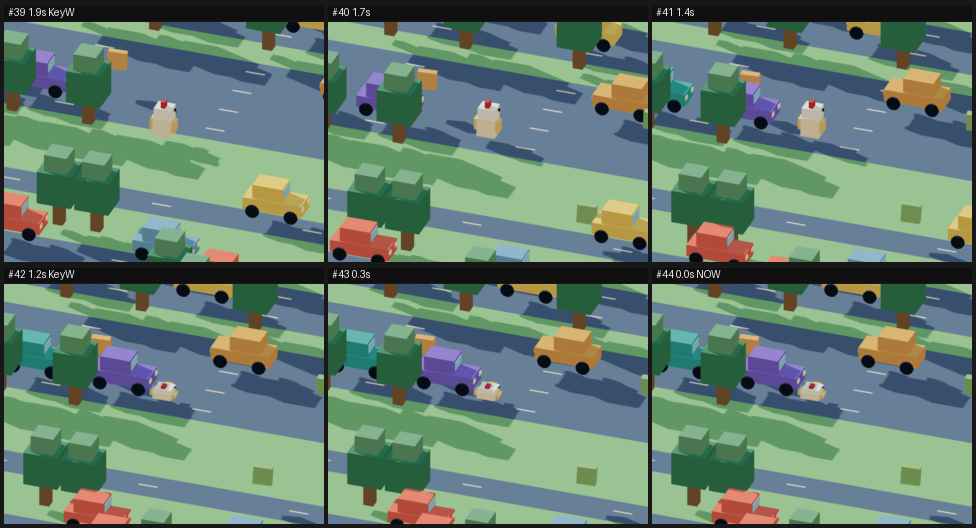

# Fast vision policy: a hosted vision model playing over WebRTC

A `decide(frame, controls)` policy for the SDK reference runner that sends the
game to a **hosted vision model behind an OpenAI-compatible
`/chat/completions` API** and plays the keys it plans. It is a guide and a
reference, not a tuned player: it shows the shape of a fast API loop, how to
see exactly what the model was given, and what we measured when we tried it on
CrossRoad.

```
frames ──► last 6 frames ──► one captioned contact sheet ──► vision model (up to N calls in flight)
                                                                  │
game ◄── keyDown/keyUp, one slot at a time ◄── action chunk ◄─────┘
          (a newer plan replaces what is left of the old one)
```

| file | role |
|---|---|
| `policy_fast_vision.py` | `decide(frame, controls)` entry point for `scripts/remote-control/agent.py` |
| `fast_loop.py` | frame window, request pipelining, answer parsing, action-chunk player, per-call trace |
| `sheet.py` | contact sheet: N frames in one labelled image, tiles keep the frame's aspect |
| `trace_cli.py` | print what each call did, in the terminal |
| `trace_page.py` | the same, as a live local web page |
| `test_fast_vision.py` | deterministic tests with a stubbed model (no network) |

## Run it

```sh
.venv-control/bin/python -m pip install -r scripts/remote-control/requirements.txt \
    -r packages/agent-sdk-fast-vision/requirements.txt

export ANO_MODEL_BASE_URL=https://<your-provider>/v1     # any OpenAI-compatible endpoint with image input
export ANO_MODEL=<vision-model-id>
export ANO_MODEL_API_KEY=...                             # sent as a Bearer header, never written to the trace

.venv-control/bin/python scripts/remote-control/agent.py \
    --origin https://agentnumberone.io --live-view \
    --decision-interval-ms 250 --inference-timeout-ms 3000 --max-frame-age-ms 2000 \
    --policy packages/agent-sdk-fast-vision/policy_fast_vision.py
```

Pair the printed control URL from the game page (**Connect an agent → WebRTC**)
as described in the [main README](../../README.md). `--live-view` also shows
the exact sheet sent to the model, via `controls.show_model_input`.

Watch every call as it happens:

```sh
python packages/agent-sdk-fast-vision/trace_page.py runs/fast-vision   # http://127.0.0.1:8767/
python packages/agent-sdk-fast-vision/trace_cli.py runs/fast-vision --follow
```

## How a tick works

The runner calls `decide()` on its inference thread at `--decision-interval-ms`.
Each call is cheap and never waits for the model:

1. **Keep the window.** The frame is converted once and appended to the last
   `ANO_FRAMES` (default 6 = 5 history + current).
2. **Play what is due.** If an action chunk is running, every slot whose time
   has come is sent as `keyDown` + `keyUp` (the SDK's recommended tap).
3. **Ask, if a slot is free.** With fewer than `ANO_MAX_INFLIGHT` calls out and
   `ANO_REQUEST_GAP_S` since the last launch, the window is tiled into one
   sheet and posted on a worker thread.
4. **Collect answers.** The newest picture wins: an answer decided from an
   older picture than one already held or played is dropped, and an answer
   that waited more than `ANO_MAX_ANSWER_AGE_S` is dropped as stale.

### What the model is asked

One system prompt plus one image. The built-in prompt (in `fast_loop.py`) is
written for CrossRoad; use `ANO_PROMPT_FILE` for any other game. In chunk mode
the model must first report what it sees, then plan:

```json
{"chicken": "standing", "on": "grass", "danger": "red car two lanes up, moving right",
 "keys": ["W", "none", "W", "none"], "confidence": 0.7, "why": "gap in the next lane"}
```

`keys` has one entry per slot (`ANO_CHUNK_MS / ANO_CHUNK_SLOT_MS`, default
4 × 250 ms). The loop plays them on time; a newer plan replaces whatever is
left. `ANO_CHUNK_MS=0` switches to one key per call.

**The model decides.** The loop records what the model reports (`chicken`,
`on`, `danger`) in the trace but never overrules its keys from it. The only
filters are about time (stale or superseded answers) and an optional
confidence floor (`ANO_MIN_CONFIDENCE`). Prompts state facts about the game
("trees and rocks block a hop"), not which move to make in which situation.

The model's `why` is sent to the game's text channel with `controls.say`, so it
appears in the game's chat (`ANO_SAY=0` to turn off).

### The image



Six frames, oldest first, left-to-right then top-to-bottom; the last tile is
`NOW`. Each caption is `#seq age [key]`, where the key is the one **actually
tapped between that frame and the next**. Tiles are 320 px wide and keep the
frame's aspect (320×240 for a 4:3 game), so a 6-frame 4:3 sheet is 976×528.

## Reading the trace

Every call gets a folder, and `trace.jsonl` gets one line when its outcome is
known:

```
<run>/trace/<call>/sheet.png       the one image that was sent
<run>/trace/<call>/request.json    the exact HTTP body (the API key is a header, not in here)
<run>/trace/<call>/response.json   the exact HTTP body received, or the error
<run>/trace/<call>/outcome.json    what happened to the answer
<run>/trace.jsonl                  one line per call with every timestamp
```

`trace_cli.py` prints, per call: (1) the frames aggregated and when the image
was sent, (2) the API input, (3) the API output with latency and status, and
(4) the keys sent to the game and when, or why nothing was (replaced by a
newer call, stale, planned none, low confidence). `trace_page.py` shows the same
as cards that update twice a second. `ANO_TRACE=0` turns recording off;
`ANO_TRACE_KEEP` (default 300) bounds the folders kept.

## Settings

| variable | default | meaning |
|---|---|---|
| `ANO_MODEL_BASE_URL` | — (required) | OpenAI-compatible base URL, e.g. `https://host/v1` |
| `ANO_MODEL` | — (required) | model id |
| `ANO_MODEL_API_KEY` | empty | Bearer token |
| `ANO_MODEL_TIMEOUT_MS` | 8000 | HTTP timeout per call |
| `ANO_MODEL_MAX_TOKENS` | 200 (chunk) / 120 | reply budget |
| `ANO_MODEL_DETAIL` | `high` | image `detail` field (some providers ignore it — see below) |
| `ANO_FRAMES` | 6 | frames per sheet |
| `ANO_MAX_INFLIGHT` | 1 | model calls out at once |
| `ANO_REQUEST_GAP_S` | 0.2 if in-flight > 1, else 0 | minimum spacing between launches |
| `ANO_CHUNK_MS` | 1000 | plan length per call; `0` = one key per call |
| `ANO_CHUNK_SLOT_MS` | 250 | one key (or none) per slot |
| `ANO_ACTION_GAP_S` | 0.2 (chunk) / 0.5 | minimum time between two taps |
| `ANO_MAX_ANSWER_AGE_S` | 1.0 | drop an answer that waited longer than this |
| `ANO_MIN_CONFIDENCE` | 0.3 | drop plans below this confidence |
| `ANO_PROMPT_FILE` | built-in CrossRoad prompt | your prompt; placeholders `{frames} {chunk_ms} {slots} {slot_ms} {instruction}` |
| `ANO_SAY` | 1 | send the model's `why` to the game chat |
| `ANO_RUN_DIR` | `./runs/fast-vision` | where the trace goes |
| `ANO_TRACE` / `ANO_TRACE_KEEP` | 1 / 300 | trace on/off, folders kept |

## What we measured on CrossRoad (2026-11-18)

These are observations from one afternoon with one fast hosted model
(`deepseek-v4.1-flash-fast`), on real CrossRoad frames. They are here so you
know what to look for, not as a benchmark.

**Image budget.** The provider billed image tokens by pixel area and ignored
`detail`:

| image sent | image tokens |
|---|---|
| ≤ 512×384 | 194 (floor) |
| 976×528 (6-frame sheet) | 327 |
| 1024×768 | 496 |
| ≥ 1536×1152 | 1001 (cap) |

A 6-tile sheet therefore gets roughly 50 tokens per tile. Check your provider's
`usage.prompt_tokens_details.image_tokens` before assuming what the model sees.

**It can see; asking it to decide is the hard part.** Asked directly about the
`NOW` tile of a 976×528 sheet, the model answered *standing vs squashed* and
*grass vs road* correctly 12/12 each — larger images or 2× crops did not do
better. Yet with a "give the ONE next key" prompt it answered `W` in 80 of 80
calls on a replay, including after the chicken had been hit. Making it report
what it sees first changed behaviour (it waited and backed off near cars), but
inside the planning prompt it still reported a squashed chicken as `standing`.
Read the trace, not the summary: it is the only way to tell perception from
decision errors.

**Bugs the trace caught in our own loop** (fixed here):

- Tiles were forced to 16:9, stretching a 4:3 game 1.33× sideways.
- Captions said "then pressed W" on every tile after the first press (the last
  key ever pressed, not the key pressed after that frame), telling the model it
  had been holding W the whole time.

**Timing.**

- Latency was ~0.7–1.4 s per call with an image. With 3 calls in flight
  staggered by 0.2 s, a fresh plan lands roughly every 250 ms, so usually only
  the first one or two slots of a 4-slot chunk play before the next plan
  replaces them. Lower `ANO_MAX_INFLIGHT` if you want whole chunks to play.
- Keys leave the runner only when `decide()` returns, so a slot fires on the
  first tick after it is due — up to one `--decision-interval-ms` late. Keep
  slots no shorter than the tick, or lower the tick with them.
- The default (one call at a time) skips launches while a call is out rather
  than queueing them: a queued request would carry an old picture.

## Tests

```sh
python -m unittest discover -s packages/agent-sdk-fast-vision -p 'test_*.py' -v
```

No network: the model is stubbed. Covered: one-at-a-time and N-in-flight
requests, newest-answer-wins, stale drops, chunk slot timing, a newer chunk
cutting an old one, keys played as the model gave them, caption keys,
trace files, tile aspect, `ANO_PROMPT_FILE`, and `decide()` end to end.
